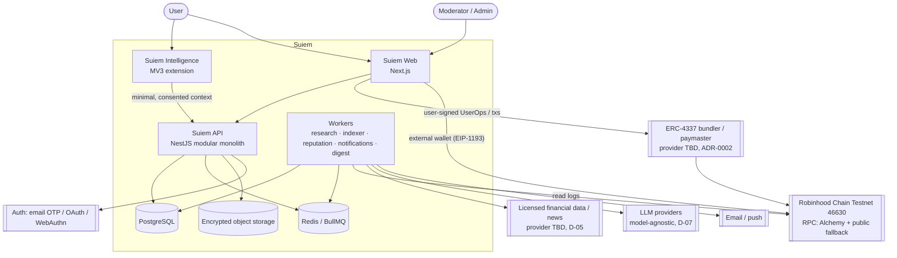
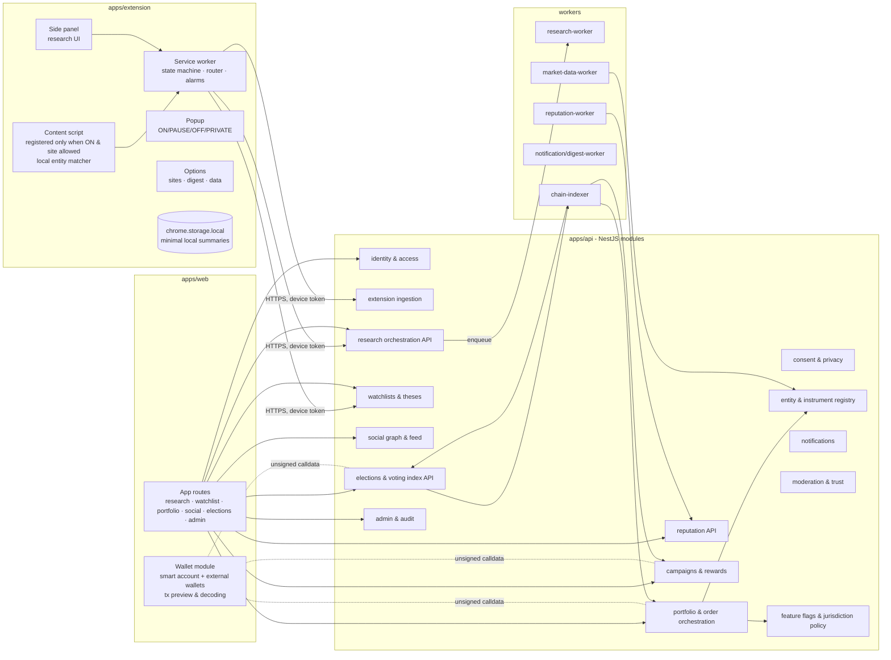
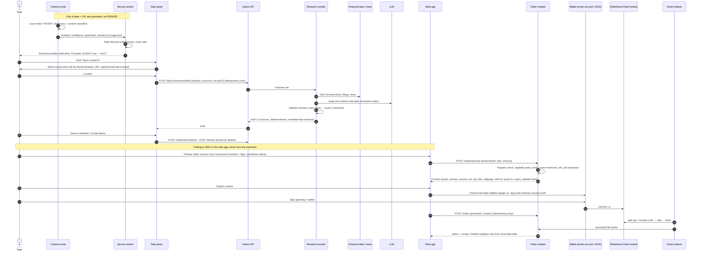
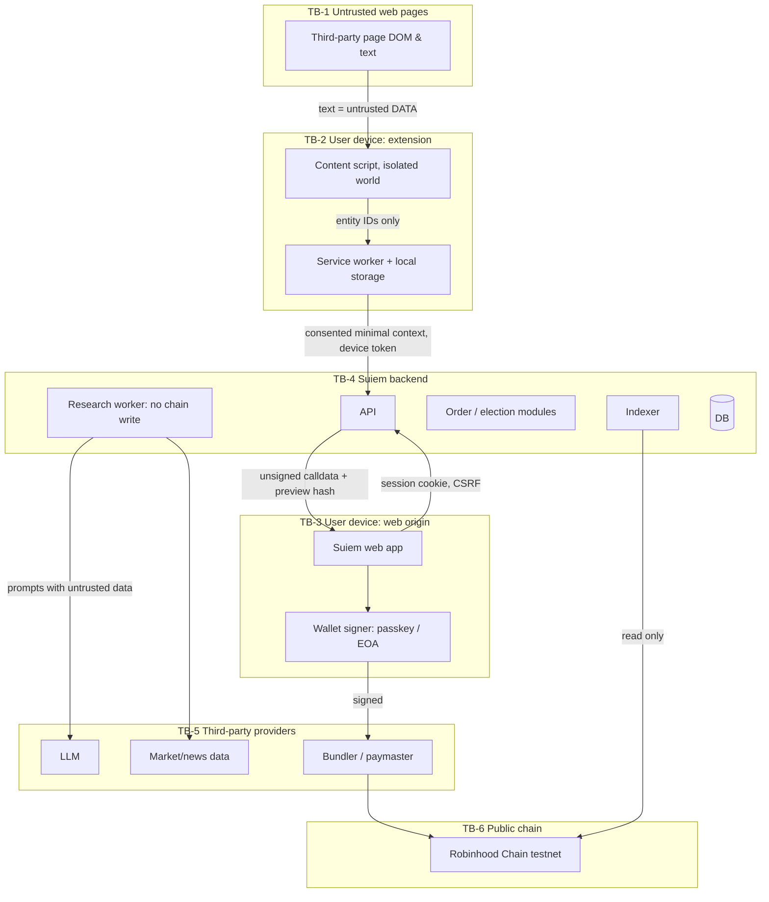

# Suiem Architecture (proposed)

Status: **Proposed. Awaiting product-owner approval.** Date: 2026-11-10.
Scope: Robinhood Chain **testnet (46630) only**, with no real funds and no real securities in any phase.
Related: `ADR/0001`–`0009`, `VERIFIED_FACTS.md`, `decisions/OPEN_QUESTIONS.md`.

## 1. Architectural principles

1. **Research and execution are separate.** AI services cannot call order, wallet or chain-write code. They live in different modules, with no import path and no network route between them.
2. **The user signs, the server prepares.** The backend may build *unsigned* calldata. Signing happens only in the user's wallet UI in the web app. The extension never signs and never submits orders (§6.7, §15).
3. **Consent gates collection at the source.** Extension state (ON/PAUSED/OFF/PRIVATE) controls whether content scripts are *registered*, not just whether UI is shown.
4. **Chain is truth for onchain facts. The ledger is truth for simulated facts.** The two are never summed.
5. **Verified registry or nothing.** No address reaches calldata unless it is in the instrument/contract registry with a verification record traceable to `VERIFIED_FACTS.md`.
6. **Modular monolith first** (§13.1). Workers are split out only for isolation (indexer, AI) or scaling.
7. **Everything versioned:** API (`/api/v1`), brief schema, score methodology, contract deployments, consent policy.

## 2. System context



## 3. Components



Hard boundary: `research-worker` has **no** credentials for chain-write, order or wallet modules. It is lint-enforced (dependency-cruiser rule) and deployed as a separate process with its own DB role (read entities, write briefs only).

## 4. Primary data flow: extension → research → watchlist/thesis → order preview → signed tx → indexer



For testnet, the order steps apply to **simulated** orders (ledger fill at a timestamped quote), or to testnet Stock Token transfers or swaps only where a verified testnet venue exists (none verified, S-06). Elections follow the same preview → sign → index pattern (ADR-0005).

## 5. Trust boundaries



| Boundary | What crosses it | Controls |
| --- | --- | --- |
| TB-1 → TB-2 | DOM text | Content script runs only when allowed. Text is matched locally and never sent automatically. No `eval`. No `innerHTML` with page data. Shadow DOM UI |
| TB-2 → TB-4 | Entity ID, URL, optional user-selected excerpt | Explicit user action and preview of shared data. Device-bound token. Schema validation. Size caps. Per-device rate limits |
| TB-3 → TB-4 | Authenticated API | HttpOnly SameSite cookies, CSRF tokens, CSP, idempotency keys |
| TB-4 → TB-3 → wallet | Unsigned calldata | Calldata built only from registry addresses. Preview hash shown and checked again before sign. Wallet shows decoded call |
| TB-4 → TB-5 | Prompts and data requests | Provider disclosure. No PII or wallet data in prompts. Retention terms (D-07). Output validated as untrusted |
| TB-6 → TB-4 | Logs, receipts | Multiple RPCs. Block-hash reorg checks. Finality tags. Never trust client-reported tx outcomes |
| Admin → TB-4 | Privileged ops | RBAC, MFA, reason codes, dual control, immutable audit |

## 6. Data model outline (PostgreSQL)

Follows PRD §14. Conventions:
- IDs: UUIDv7 (time-ordered).
- Addresses: `bytea(20)` with a checksum-validated input layer, plus `chain_id int`.
- Token amounts: `numeric(78,0)` base units, plus `decimals smallint` from the registry.
- Fiat: `numeric(20,6)`, labelled with currency. Never float.
- Append-only tables (`thesis_versions`, `order_events`, `indexed_chain_events`, `reputation_evidence`, `audit_logs`, `consent_records`) are protected by triggers that reject UPDATE/DELETE. Deletion for privacy is done by anonymization jobs.
- `book enum('simulated','testnet','live')` on every position, order and ledger row. `live` is CHECK-blocked until a flag migration.
- Row-level security on user-owned tables, keyed by `app.user_id`.

## 7. Technology stack (confirms PRD §13.2, adjusted; ADR-0009)

| Concern | Choice | Justification |
| --- | --- | --- |
| Monorepo | pnpm workspaces + Turborepo | Strict dependency isolation, cached CI |
| Language | TypeScript (strict) everywhere except Solidity | Shared schemas across extension, web and API |
| Web | Next.js (App Router) + React | PRD default. Pin exact versions (Banchor's caret ranges were non-reproducible) |
| Extension | MV3 + React + Vite via **WXT** | Typed manifest generation, side-panel support, HMR, and a Playwright-friendly build |
| API | **NestJS** (Fastify adapter) | Explicit modules match §13.1 domains. Guards and interceptors suit auth, idempotency and audit. OpenAPI generation |
| Validation | **Zod** schemas in `packages/shared`, shared by all apps. OpenAPI via `zod-openapi` | One source for brief schema, events, API DTOs |
| DB | PostgreSQL 16 + **Drizzle ORM** migrations | SQL-first, typed, `numeric` handled as string/bigint, plain SQL migrations reviewable |
| Queue/cache | Redis + BullMQ | PRD default. Fine at this scale |
| AI workflow | Deterministic step pipeline (BullMQ flow). LangGraph JS only where branching justifies it | §7.5 "do not introduce agentic autonomy" |
| Contracts | Solidity 0.8.x + Foundry + OpenZeppelin 5 (pinned via `forge install` git submodule or soldeer, not npm) | PRD default. Fuzz/invariant built in |
| Chain client | **viem** (not ethers) | Already used successfully by Banchor. Typed ABIs via abitype/wagmi-cli from Foundry artifacts. First-class ERC-4337 (`viem/account-abstraction`). Tree-shakeable for extension and web. Using one library avoids two BigInt/ABI encoding paths |
| Wallet UI | wagmi + viem. Smart-account SDK per ADR-0002 (Alchemy Account Kit or ZeroDev, to be decided after testnet support is verified) | — |
| Observability | OpenTelemetry SDK → OTLP collector. Pino logs with redaction | PRD default |
| Testing | Vitest (unit), Testcontainers (Postgres/Redis integration), Playwright (web plus extension E2E), Foundry (contracts), anvil fork of 46630 | — |
| CI | GitHub Actions. Gitleaks, osv-scanner/`pnpm audit`, CodeQL, Slither | §16.2 |

## 8. Threat model (PRD §16.1)

STRIDE-tagged (S spoofing, T tampering, R repudiation, I info disclosure, D DoS, E elevation). Each threat has at least one control and a test owner phase.

| # | Threat (§16.1) | STRIDE | Primary controls | Verified in |
| --- | --- | --- | --- | --- |
| TM-01 | Account takeover | S, E | Passkeys/WebAuthn preferred. MFA for admins. Session rotation. Anomaly-based step-up. Rate-limited login | P2, P8 |
| TM-02 | Wallet compromise | S, E | Keys never server-side. Smart-account guardian/recovery (ADR-0002). No standing session keys. Exact approvals only | P2, P4, P7 |
| TM-03 | Malicious extension update | T, E | Signed releases. Web Store publishing restricted to two maintainers with 2FA. Reproducible build hash published. Minimal permissions limit blast radius | P3, P8 |
| TM-04 | Content-script injection / page-hostile DOM | T, I | Isolated world. No `innerHTML` from page data. Closed Shadow DOM. Strict extension CSP. No remote code or fonts | P3 |
| TM-05 | Prompt injection via web content | T, E | Page text delimited as data. Structured output with Zod. Claim→source validation. No tools that act. Research worker has no execution credentials. Per-user cache keys (fixes Banchor R-4) | P3, P4 |
| TM-06 | Malicious or stale financial data | T | Licensed providers. Freshness SLAs per figure. Cross-provider sanity checks. `dataFreshness` surfaced. Market-hours guard | P4 |
| TM-07 | Fake stock/token instruments | S | Registry-only addresses. Dual-control registry admin. Onchain `name/symbol/decimals` check. UI `TEST:`/`SIM:` badges | P4 |
| TM-08 | Transaction substitution | T | Server-built calldata from registry. Preview hash bound to calldata. Wallet shows decoded call. Client re-derives and compares before sign (fixes Banchor R-1). No intents in URLs | P4, P7 |
| TM-09 | Phishing / fake token contracts ($WIF lookalikes) | S | Address allowlist from `VERIFIED_FACTS`. Domain allowlist. Never resolve a token by symbol. Warning UI for unknown tokens | P2, P7 |
| TM-10 | Replay / double submission | T, R | Idempotency keys (DB unique). Onchain per-voter nonces/vote IDs. Chain ID in every signature domain (EIP-712) | P2, P7 |
| TM-11 | Indexer reorg / event duplication | T | Unique `(chain_id, tx_hash, log_index)`. Parent-hash continuity check with rollback. `safe`/`finalized` tags. Backfill and full rescan | P7 |
| TM-12 | Reputation manipulation | T | Evidence-only inputs. Diversity-weighted helpful votes. Rate limits. Versioned methodology. Appeals | P6 |
| TM-13 | Sybil voting | S | Eligibility policy (verified account + wallet link + age). Per-wallet caps (D-03). Offchain farmed-vote review before finalization. Disputes | P7 |
| TM-14 | Wash trading / fake performance | T | Only reconciled fills count. Simulated results excluded from live-verified score. Benchmark-relative and drawdown-aware metrics. Minimum history | P6 |
| TM-15 | Sponsor / reward fraud | T, R | Prefunded escrow. Rules hash onchain. Approval role separation. Claim windows. Refund paths | P7 |
| TM-16 | Insider / admin abuse | E, R | RBAC least privilege. Dual control for registry, election and treasury. Immutable audit logs. Multisig + timelock on contracts | P2, P7 |
| TM-17 | Cross-user data leakage | I | Postgres RLS. Tenant-scoped repositories. Authorization tests per endpoint. No shared AI caches across users | P2+ |
| TM-18 | Insecure API keys / secrets | I | Secret manager. `.env.example` only. Gitleaks in CI. Short-lived OIDC deploy creds. No keys in the extension bundle | P2 |
| TM-19 | Dependency / supply-chain compromise | T, E | Exact pins plus lockfile review. `pnpm` with `onlyBuiltDependencies` allowlist. osv-scanner. Renovate with review. Signed commits on release branches | P2, P8 |
| TM-20 (added) | Browsing-data over-collection / privacy breach | I | Consent state machine gating script registration. Local-first summaries. Data inventory. Retention jobs. Export/delete | P3 |
| TM-21 (added) | Testnet asset misrepresented as real | S | Mandatory badges. Copy review. No x-suffix tickers. Separate books. Disclaimers per screen | P4 |
| TM-22 (added) | DoS on public endpoints / AI cost exhaustion | D | Per-user and per-IP rate limits. Job quotas. Spend caps per provider | P2, P3 |

Assumptions: the user's OS and browser are not compromised. Robinhood Chain sequencer liveness is outside Suiem's control (it degrades to read-only). Testnet may be reset by Robinhood (T-04, RH terms), so the indexer must tolerate a chain reset by detecting genesis-hash changes.

## 9. Proposed monorepo layout

```
suiem/
├── PRD.md, Suiem_PRD.md
├── apps/
│   ├── web/                 Next.js app (user + admin routes behind RBAC)
│   ├── extension/           WXT MV3: background, content, popup, sidepanel, options
│   └── api/                 NestJS modular monolith (one module per §13.1 domain)
├── workers/
│   ├── research/            deterministic research pipeline (no chain-write deps)
│   ├── indexer/             chain event ingestion, reorg/finality
│   ├── reputation/          versioned score jobs
│   ├── notifications/       notification + digest delivery
│   └── market-data/         provider adapters, quote freshness
├── packages/
│   ├── contracts/           Foundry: src/ test/ script/ deployments/<chainId>.json
│   ├── shared/              zod schemas, money/decimal utils, entity dictionary, event taxonomy, consent states
│   ├── chain/               viem clients, typed ABIs (generated), registry-checked calldata builders
│   ├── db/                  drizzle schema + SQL migrations + RLS policies
│   ├── ui/                  design system (tokens, components, a11y primitives) for web + extension
│   └── config/              eslint, tsconfig, prettier, chain config sourced from VERIFIED_FACTS
├── infra/                   IaC (later), docker-compose for local Postgres/Redis/anvil
├── docs/                    audits, ADRs, plans, runbooks, decisions
└── reference-banchor/       git-ignored, read-only
```

Dependency rules (CI-enforced): `workers/research` must not depend on `packages/chain` write builders or `apps/api` order modules. `apps/extension` must not depend on `packages/chain`. `packages/shared` has no runtime I/O.
